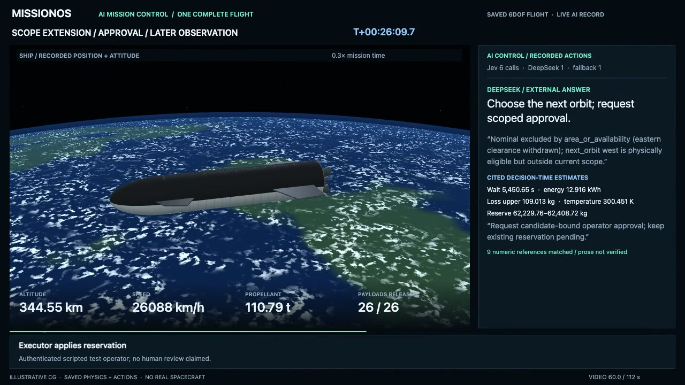

# M3: AI mission control, one complete flight

[Watch the full 112-second video](https://github.com/user-attachments/assets/a7cce1eb-ab3e-437e-8d0b-ac6c05bf0418) · [Higher-bitrate repository copy](mission.mp4) · [Open the offline replay](index.html)



One saved flight: launch, 26 rigid payload releases, an operational-clearance
update, DeepSeek's next-orbit decision, a candidate-bound scope grant, and the
executed return. The booster view uses this same flight's recorded trajectory.
The video shows the entire saved mission timeline at changing playback speeds.
Its 112 seconds are presentation time; the final four seconds hold the end frame.

Generic rigid payloads only: unfolding, communications, and orbit raising are not
implemented. Geometry, Earth, and plumes are illustrative. Motion, attitude,
actuator states, model choices, and metrics come from the saved numerical record.

## What the video establishes

- Jev: 12 attempts, 11 valid adopted decisions. One rejected response and its
  checked continuation fallback remain visible.
- DeepSeek: one adopted next-orbit decision; nine reference IDs were resolved
  against the decision-time numerical inputs. The displayed excerpts are from
  its external answer. Reference agreement does not verify all of its prose.
- An authenticated **scripted test operator** grants the requested scope. This is
  a real recorded HTTP/ledger path, not evidence of human review or production SSO.
- The grant is consumed once. A later observation confirms the reservation;
  return dispatch and contact occur later on the same mission clock.
- Ship contact: 4.613 m/s. Booster contact: 1.884 m/s at nominal separation state.
  Contact does not establish water survival or flight-qualified recovery.

No model calls or physics integration run in this page or during media export.
The saved flight does not establish arbitrary recovery-site precision, numerical
convergence, or booster disturbance robustness.

## Public data and provenance

`data.json` is a reviewed display allowlist, not the private raw study.
`manifest.json` records the raw study's digest, reviewed-summary digest, render
source digests, exact same-flight state handoff, and output media digests.
The raw study is not distributed; public readers can verify this bundle's
integrity, not independently authenticate the unavailable original source.

Only numerical display fields, bounded action names, the model's external
summary, resolved numerical reference fields, and approval-chain event types are
exported. Private paths, session/request IDs, credentials, signatures, provider
exchanges, and internal reasoning are excluded. Satellite motion is shown only
within each body's saved samples; tracks are not extrapolated past their end.
Position interpolation and quaternion slerp are display operations only.

The procedural renderer files are byte-identical copies of the earlier public
Starship replay renderer. The old media bundle is unchanged.

## Reproduce presentation from the public bundle

Run from the repository root:

```sh
python docs/assets/starship-ai-mission-m3-20261012/export_saved_media.py --check
python docs/assets/starship-ai-mission-m3-20261012/export_saved_media.py --serve --port 18880
```

Open the printed loopback URL in a WebGL-capable browser. `Jump to AI decision`
shows the explanatory frame. `Export 112-second video` records the canvas at
24 fps. Keep the page visible while recording. The scoped loopback writer accepts
only `mission.webm` and `mission.png`, at most 64 MiB each, with a same-origin
request and matching file signature. Existing captures are never overwritten.
Opening `index.html` directly also works offline and offers a native blob download.

With `ffmpeg` and `ffprobe` installed, generate publication files:

```sh
python docs/assets/starship-ai-mission-m3-20261012/export_saved_media.py --make-media --check
```

`mission.mp4` uses H.264 with full-range 8-bit 4:2:0 (ffprobe: `yuvj420p`),
1280×720, 24 fps, fast-start metadata, and a
20 MiB size limit. `mission-preview.gif` is an explicitly abbreviated preview;
use the MP4 for the complete timeline. No output is overwritten automatically.
Curation from a new private source requires its independently reviewed completed
M3 summary, matching study digest, and exact launch/return state handoff; it is
not needed to replay or validate this public bundle.

## GitHub inline attachment

The inline player uses a smaller encode of the same 112-second, 2,688-frame
movie to fit GitHub's 10 MB attachment limit. It has the same dimensions and
timeline. The manifest records its URL, byte count and digest. To reproduce the
attachment encode from the repository MP4:

```sh
ffmpeg -hide_banner -loglevel error -n -i mission.mp4 -an -c:v libx264 \
  -preset medium -crf 26 -maxrate 600k -bufsize 1200k -pix_fmt yuv420p \
  -r 24 -t 112 -movflags +faststart mission-github.mp4
```
