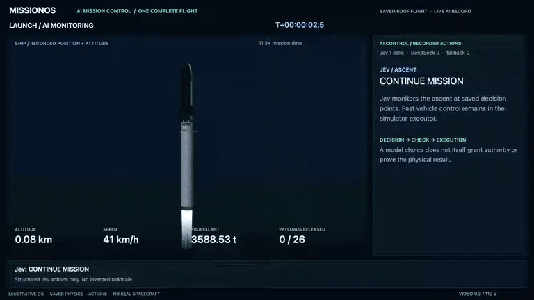

# AI mission control, from launch to return

MissionOS supervises a recorded Starship-inspired six-degree-of-freedom flight:
launch, release of 26 payloads, a recovery-area closure, a new return plan,
operator approval and measured contact. Jev and DeepSeek were called during the
original execution. The video replays that saved execution and its decisions.

*Payloads are generic rigid bodies. Solar-array deployment, communications and
orbit raising are outside this model. The geometry and exhaust are illustrative;
the displayed motion and metrics come from saved simulation states.*

**[Watch the complete mission video](../assets/starship-ai-mission-m3-20261012/mission.mp4)** ·
[Interactive replay](../assets/starship-ai-mission-m3-20261012/index.html)

## What the AI does

Jev monitors ascent and deployment, makes the early booster return choice, and
responds to orbital updates. When the authorized recovery option becomes
unusable, DeepSeek compares the available evidence and chooses a next-orbit
return that requires an approval extension. MissionOS requests that extension,
checks the response, changes the reservation and observes the later execution.
The Ship releases 26 payloads and reaches model surface contact at about
4.613 m/s. The same flight's booster meets its nominal water-entry constraints
at about 1.884 m/s.

The control overlay separates five things: the observation available then,
the candidate calculations, the AI's selected action, the authority/constraint
check, and the later observed effect. DeepSeek's displayed explanation is its
returned decision summary. Jev's display shows its structured selection. Numeric
references are resolved against the inputs available at that decision; free-text
reasoning is not independently proven by this check.

Playback is compressed and its scale changes by phase. The simulation clock and
playback rate stay visible. Launch, deployment and return are from one execution,
with matching states at their boundary; the video does not splice a different
successful return onto a launch.

## Approval and verification

The initial chat planner selected a registered scenario using a fixture. The
flight decisions used actual model services. The inflight approval in this
record was supplied by an authenticated **test-operator script**, after the AI
requested it, through the same HTTP approval boundary. It was consumed once and
confirmed by a later observation. This exercises the approval mechanism; it is
not a record of a human reviewing the request.

The displayed flight contains 11 valid Jev responses in 12 attempts, one valid
DeepSeek response and nine resolved numeric references. Its checked fallback
remains part of the record. Across the four completed M3 roles, the totals are
43/44 Jev responses, 2/3 DeepSeek responses and 25/25 resolved references.
The four roles cover nominal operation, deployment failure, an approval
extension, and uncertain recovery comparisons. These are development cases,
not an estimate of model reliability on unknown missions.

[The complete M3 record and boundaries](../agents/starship-m3-final-validation.md)

## Scope of the result

This is a working AI control and verification path in a numerical simulator.
Contact criteria do not establish spacecraft survival, recovery or reuse. The
booster result is limited to one nominal separation trajectory; fuel ±1 t
changes failed its return constraints in the subsequent diagnostic. The Ship's
landing sensitivity also depends strongly on the controller update cadence.
Those results are retained in the [recovery diagnostic](starship-recovery-sensitivity.md).

The AI is assessed on the control work it performs: noticing changes, using
observations and calculations, deciding, executing within approved bounds and
checking what happened. Rules and fallbacks constrain execution and cover
failures; matching their answer does not erase the AI's executed work.
