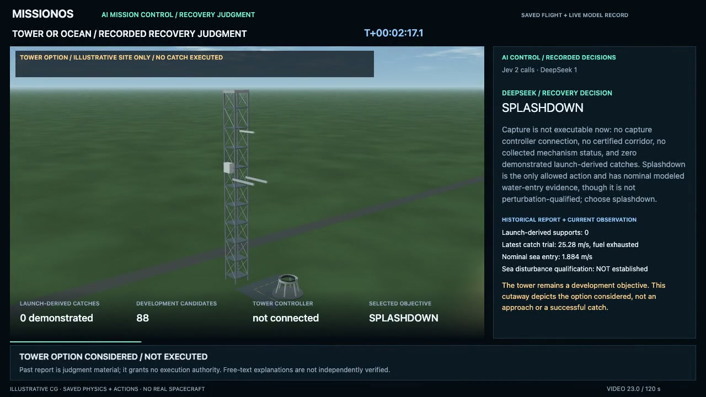

# Tower or ocean: a recorded recovery judgment

MissionOS passes the current catch-development report and the booster observation
to DeepSeek inside the mission. DeepSeek selected splashdown; the independent
execution check accepted it and a later observation confirmed the selection.
The same flight reached its modeled water-entry limits.

[Play the 120-second video](https://github.com/user-attachments/assets/00a07f6d-93a3-407b-9f38-b6d017bd1c72)
· [Interactive replay](../assets/starship-booster-recovery-decision-20261014/index.html)

The tower is visible at launch and in a labeled option cutaway. Capture has zero
demonstrated launch-derived supports and its controller remains unconnected;
only ocean return is currently executable. No tower approach or catch is depicted.
Payloads are generic rigid bodies: unfolding, communications and orbit raising
are not modeled.

| Recorded fact | Result |
| --- | --- |
| DeepSeek booster choice | Splashdown, accepted without fallback |
| Booster CG speed at sea contact | 1.847 m/s, nominal separation only |
| Payloads released | 26/26 |
| Ship contact-point speed | 4.608 m/s, low-speed contact |
| Separate Ship orbital-comparison gate | Incomplete after a model-summary rejection |

The video shows the model's external explanation and actual telemetry. Hidden
reasoning is excluded; the explanation's prose is not independently verified.
The first rejected booster answer and a separate API diagnosis remain recorded.
This demonstrates the requested recovery-judgment path, rather than a newly
completed M3 campaign, robust recovery or real spacecraft operation.

[Reviewed record and limitations](../assets/starship-booster-recovery-decision-20261014/summary.json)
· [Authority and verification contract](../agents/starship-booster-recovery-history.md)
