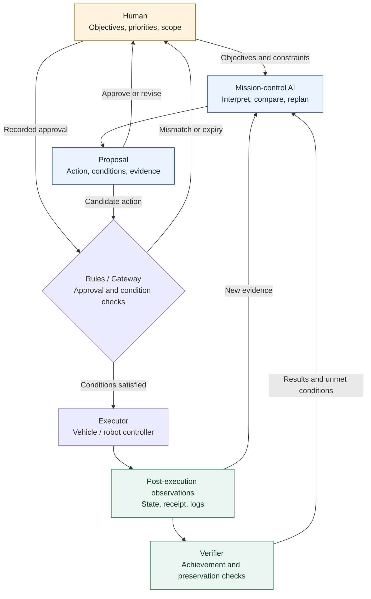
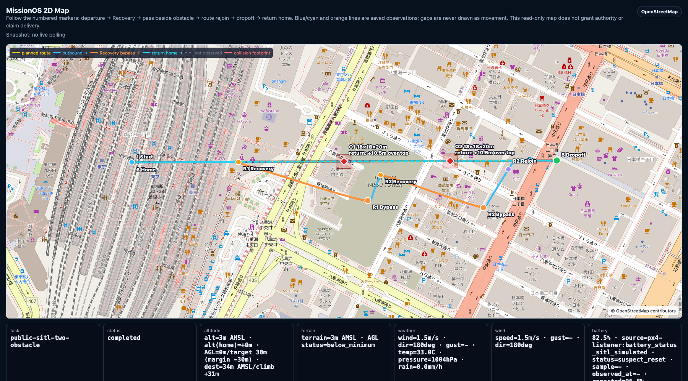
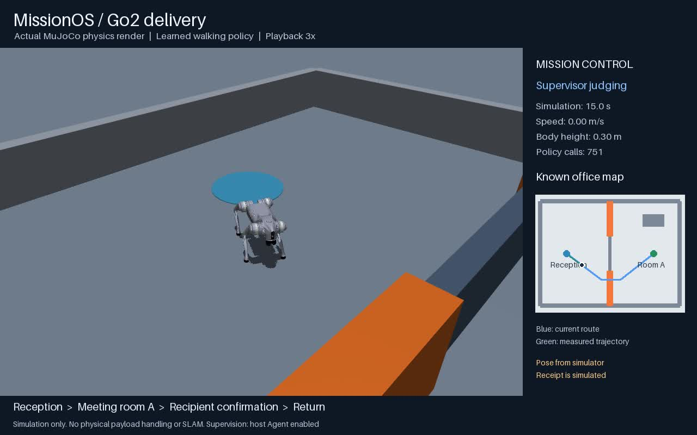
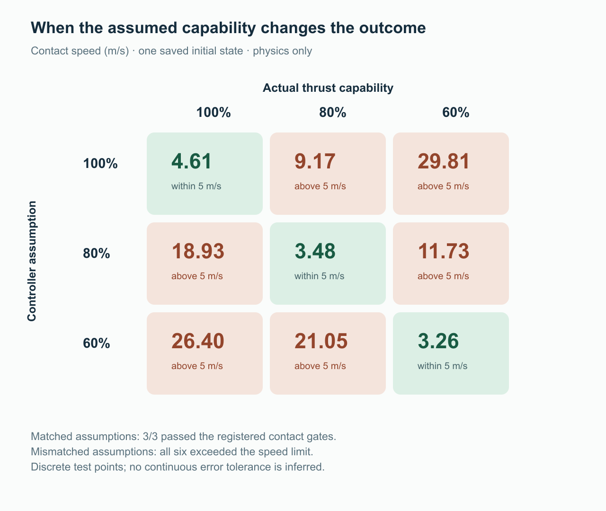
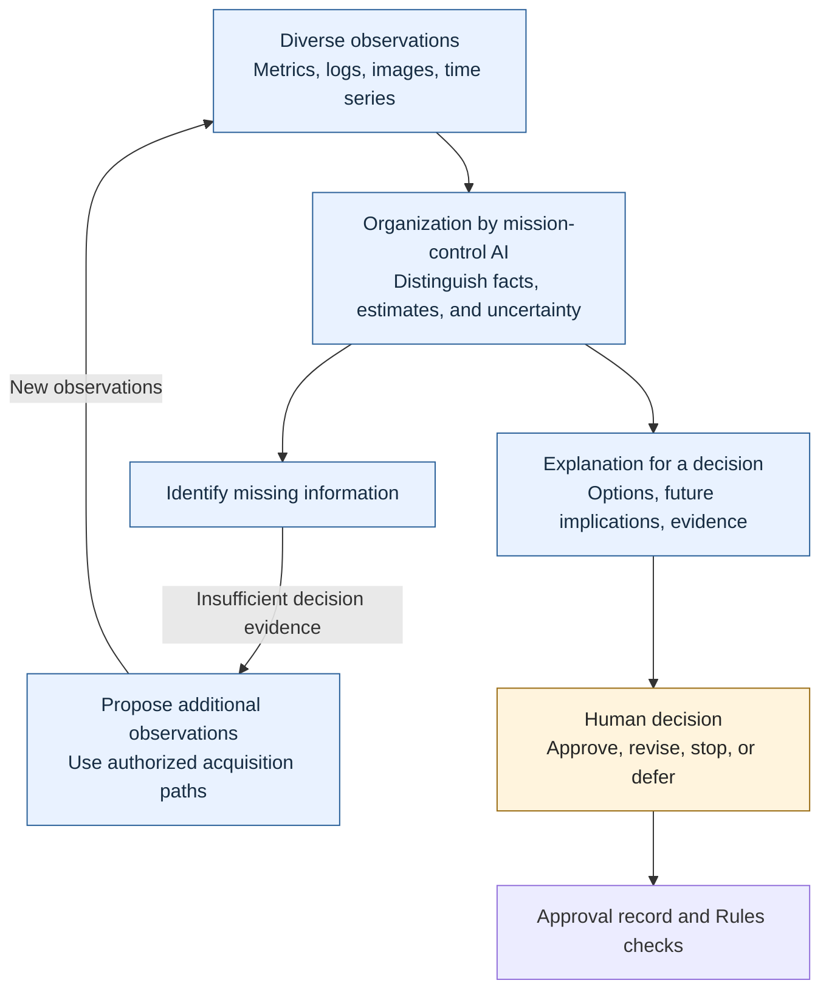

# MissionOS: A Mission-Control Layer Connecting AI Agents and Physical AI to Human Judgment
## Design and simulation cases for expanding what one person can supervise

**Type: Technical report (design and development record) / draft (not peer-reviewed)**  
**Date: 29 October 2026**  
**Source basis: MissionOS public revision `56013c8bd656b77e707a65e691be0f8c6f050ca5` and the development account published on 28 October 2026.**

## Abstract

Turning the capabilities of AI-equipped drones and robots into capabilities that people can operate over time requires a mission-control layer connecting observation, judgment, authority management, and outcome verification. MissionOS places a mission-control AI agent between human objectives and execution systems, connecting AI judgment, human approval, deterministic execution constraints, vehicle and robot actions, and verification based on observations. This report presents a case study of that design and its existing simulation records. The cases cover drone obstacle avoidance, indoor navigation, waiting and replanning by a quadruped robot, continuation and stopping decisions in block stacking, repair attempts after manipulation failures, and a continuous space mission inspired by Starship. The work contributes three elements: common authority and evidence management across heterogeneous execution systems; repair evaluation that separates contact, condition satisfaction, and sustained stability; and mission control that uses diagnosis to incorporate capability estimates into execution plans. In a nine-point thrust-sensitivity study, all three conditions with matching assumed and actual thrust met the contact criteria, while all six mismatched conditions exceeded the speed limit. Building on this result, the project tested a structure that estimates capability from additional observations and incorporates that estimate into the return plan. The report also develops a design hypothesis: mission-control AI can translate complex metrics, large volumes of logs, images, and time-series changes into material for human decisions, with supporting evidence and uncertainty. Effects on the number of missions one person can supervise and on cognitive workload will be tested in future comparative studies with human participants.

**Keywords:** MissionOS, AI agents, physical AI, mission control, humans and automation, situation awareness, execution authority, outcome verification

## 1. Introduction

One person communicates objectives to multiple drones and robots, oversees their activities, and makes decisions when needed. Over longer timescales, that person supervises a rocket mission from launch to return together with AI. MissionOS began as an effort to build the mission-control layer needed for this kind of operation.

Autonomous flight, locomotion to a destination, and grasping an object are each important capabilities. Operating them as missions also requires the ability to interpret changes in state, coordinate stages, and confirm outcomes. These decisions include whether to wait or replan when a passage is blocked, what to preserve while repairing a partially completed task, and whether an anomalous observation originates in the vehicle or its sensors.

The problem addressed here is that, even as individual machines become more autonomous, operational scale remains constrained by the attention bandwidth available for human supervision if understanding the situation, coordinating stages, and handling exceptions all remain concentrated on the person. MissionOS places a mission-control AI between the person and the execution systems to take on this work. It aims to expand the scope over which one person can maintain meaningful supervision by assigning interpretation of observations, comparison of options, and preparation of proposed changes to AI, while the person retains objectives and responsibility.

This report separates three research questions.

1. **RQ1: A common operational structure.** Can proposal, approval, constrained execution, observation, and verification be connected through a common structure across different vehicles and models?
2. **RQ2: Connecting judgment to outcomes.** Can an AI judgment made in response to changing conditions be traced through authorized execution to its subsequent outcome?
3. **RQ3: Extending human capacity.** Does this structure reduce the burden of human decision-making and increase the number of missions a person can supervise?

The existing records answer RQ1 and RQ2 through bounded cases. RQ3 is a hypothesis that directs the design and remains to be tested through comparative experiments with human participants.

## 2. Contributions

During MissionOS development, operating vehicles and models as missions made three questions concrete: how to preserve authority, how to determine completion, and what to investigate when an anomaly occurs. This report presents three contributions from the resulting designs and execution records.

1. **Common authority and evidence management across heterogeneous execution systems.** A common structure for proposals, approvals, execution constraints, actions, and outcome checks was applied to drones, mobile robots, robot arms, and space missions. The design delegates vehicle-specific actions to each execution system while managing who authorized what, and what happened, at the mission level.
2. **Repair evaluation that separates contact, condition satisfaction, and sustained stability.** Repair tests measured reaching the target, temporarily satisfying the goal conditions, and retaining that state separately. This identified the stage reached by a repair attempt and the capability requiring further improvement, making the conditions needed for a completion verdict explicit.
3. **Sensitivity testing of capability estimates and mission control informed by diagnosis.** Across the nine thrust-sensitivity test points, agreement between assumed and actual thrust separated the conditions that met the contact criteria from those that failed. Building on this result, the project implemented and tested a mission-control structure that uses additional observations to distinguish candidate causes and incorporates numerical capability estimates into plans.

These contributions extend the focus from the ability of individual machines to act to the operational structure needed for a person to supervise multiple missions over time.

## 3. MissionOS Design

### 3.1. The mission judgment layer and the action layer

MissionOS is intended as a higher-level mission-control layer independent of whether AI runs on the vehicle or in an external computing environment. Fast attitude control, walking, path following, and robot-arm motion belong to their respective execution systems. The mission-control agent works with objectives, current state, feasible options, and remaining constraints.

The Chief Agent provides the conversational entry point; specialist agents handle mission planning; the Recovery Agent addresses changes during execution; and the Repair Agent proposes corrections after failure. These agents judge and propose. The Gateway checks approval records and execution conditions and constrains dispatch to the Executor. The Verifier compares observed outcomes with defined achievement conditions separately from the model's explanation. [\[1\]][m-overview][\[2\]][m-roles]

> LLM judges. Human approves. Rules constrain. Executor acts. Verifier checks. Repair loops.

This principle means retaining the AI's output, the scope a person permitted, and the changes that actually occurred as independent facts.

*Figure 1. Authority and information flow in MissionOS. Proposals proceed to execution through recorded approval and Rules checks; observations and verification results return to inform the next judgment. This conceptual diagram represents the structure shared across the cases. [\[1\]][m-overview][\[2\]][m-roles]*  
[PNG version of Figure 1](../assets/missionos-control-layer-report/figure-01-architecture.png)

### 3.2. Approval scope and continuing supervision

Human approval is bound to a specific objective, operation, target, and set of conditions. If several stages are included in the scope approved at the outset, execution can proceed within that scope without creating new authority for every stage. Success in the preceding stage does not itself create authority for the next operation. If changed conditions or approval expiry place an action outside the scope, execution stops or a proposed amendment returns to the person.

The parent-mission implementation binds the stage order, execution systems, child contracts, conditions for evaluating each result, and approval. In one example, PX4, Nav2, and GR00T ran sequentially under the same parent run identity, and each stage met its bounded conditions. Because the three simulators did not share one world or one object, completion of the parent mission as a whole remained unverified. [\[3\]][m-parent]

### 3.3. Facts distinguished in the record

MissionOS distinguishes at least the following facts.

**Table 1. Facts recorded separately by MissionOS and their interpretation.**

| Fact | What it establishes | What that fact alone does not establish |
|---|---|---|
| Proposal | What the AI put forward as a candidate | Human approval or execution authority |
| Approval | The scope a person permitted | Command transmission or successful action |
| Dispatch and acknowledgment | What was sent across the execution boundary and what was accepted | A change in physical state or mission completion |
| Observations during execution | How position, state, and progress changed | Satisfaction of all achievement conditions |
| Verification result | Which achievement and preservation conditions were confirmed | An unobserved handover or safety on real hardware |
| Repair proposal | What to change and try next | Approval to execute again |

This separation makes it possible to investigate where expectations and outcomes diverged among judgment, authority, execution, and observation. It also keeps a persuasive explanation distinct from a completed mission.

## 4. Method and Sources

This report is a retrospective case study based on saved public reports. The sources were reread to align the environment, whether AI was invoked, the approval method, execution outcomes, and verification scope. No new vehicle actions, simulation trials, or experimental model inference were performed for this report.

The records were interpreted at three levels.

- **Structural verification:** proposals, approvals, execution, and outcome records are connected.
- **Capability observed under the tested conditions:** actions or changes in achievement conditions are observed in a particular state.
- **Usefulness assessed by comparison:** improvement over a control is measured under matched conditions.

Operation of the structure is not taken to imply improved model capability or reduced human workload. Results with different initial states, observations, stopping rules, code versions, or trial counts are not pooled into a common success rate. All actions and outcomes discussed below are evidence from simulators.

The public revision fixes the source material; it does not mean that every experiment ran on that revision. In particular, the integrated Starship trial is a historical record from development version `81c22072`, as identified in the public report. The provenance of the original execution records is kept separate from the code version at which the public sources were read. [\[8\]][m-space]

## 5. Cases and Results

### 5.1. A common supervision structure for flight and indoor navigation

In PX4 / Gazebo SITL, two obstacles at approximately 50% and 75% of route progress were handled through separate LLM proposals and human approvals, followed by avoidance maneuvers. Rejoining the route centerline after the second maneuver and outbound and return telemetry were recorded. Figure 2 shows these two responses along the route of the same mission. [\[1\]][m-overview]

*Figure 2. Observed responses to two obstacles in PX4 SITL. Blue and cyan show saved outbound and return telemetry; orange shows avoidance routes following individual proposals and approvals. Unobserved segments use a different line style. Basemap: © OpenStreetMap contributors. [\[1\]][m-overview]*

In TurtleBot3 / ROS2 Nav2, a chat request naming a room was connected to indoor navigation. The robot traversed three doorways from the front yard to the bedroom in a virtual house, with the approved route paired with the observed trajectory corrected by localization. [\[1\]][m-overview]

These two cases applied a common operational structure—stating an objective, approving a proposal, acting, and observing the outcome—to different execution systems for outdoor flight and indoor navigation. They made the division of roles between vehicle-specific execution and mission supervision concrete.

### 5.2. Waiting and replanning with Go2

In a Go2 / MuJoCo delivery case, a temporary passage closure led to two actual DeepSeek judgments. The first selected an explicit ten-second wait; the second selected replanning to the same approved destination. The proposals passed Rules checks, followed by confirmed resumption of movement, simulated receipt, return to reception, and a five-second terminal hold. [\[4\]][m-go2]

*Figure 3. Waiting for a judgment at simulation time 15 seconds in the Go2 delivery trial. The robot, blocked passage, mission state, and known map appear in the same view. Saved judgment records and observations link waiting and replanning to the subsequent receipt and return. [\[4\]][m-go2]*

At decision time, a facility notice supplied an estimate of when the passage would reopen. The mission-control agent connected that notice and the current state to a waiting proposal, then proposed replanning after a fresh observation. The supervisory cycle—responding to a change by waiting, updating the information, and taking the next action—was followed through resumed movement and return.

The same public report includes a separate case involving local stopping and yielding around a moving obstacle. That case had zero LLM judgments and was recorded as an example of a local response handled by the execution system. Together, the cases illustrate a design that assigns mission replanning and local motion adjustment to different layers.

### 5.3. Prediction and stopping decisions in block stacking

The block-stacking work addressed the decision to stop and preserve accumulated results, alongside the ability to perform the next operation. Forecasts from either a task-specific ExtraTrees predictor or a neural ACWM were supplied to DeepSeek, connecting bounded human preapproval, Rules, execution by SmolVLA, and verification through observations. [\[5\]][m-stacking][\[6\]][m-acwm]

The ExtraTrees integration retained scores of eight and eight in two known cases; the neural ACWM integration retained nine and four in a different pair of cases. The two integrations used different case sets and are reported as their respective execution records. In the neural ACWM case, the physics simulation paused while waiting for inference.

The relationship to the controls was also retained. The deterministic stopping rule scored eight and nine on the same two cases used by the ExtraTrees integration. All 15 judgments in the neural ACWM integration matched the existing threshold policy. In those two neural ACWM cases, the existing threshold policy could reproduce the continuation and stopping choices.

The resulting design insight is to distinguish supplying predictions as decision evidence from selecting an action based on that evidence. Where the relationship between a prediction and the stopping conditions is specified, rules can make the selection. The focus for delegating judgment to mission-control AI is on situations involving competing candidate causes or missing observations, where the applicability of existing decision conditions is itself in question. Section 6.3 discusses this relationship to the Starship diagnosis case.

### 5.4. Repair after manipulation failure and stable completion

The robot-arm repair work addressed correcting a remaining failure after partial task success while preserving the conditions already satisfied. [\[7\]][m-repair]

GR00T repair trials continued in the same world without resetting it, with bounded execution under a new contract and human approval. In the single-attempt cohort whose procedure was amended after observation, zero of five repair loops showed improvement in the target condition. The record connected the path from approval of a repair proposal to execution with the conditions that remained unmet afterward.

Cosmos Policy and VLA-0 were compared in diagnostic MuJoCo clones restored from a saved state. This evaluation was separate from the approved GR00T repair loops and used the same saved state, three-centimeter diagnostic displacement, instruction, and 128-action ceiling. Under conditions where a privileged reference controller achieved repair followed by a 20-step hold in all three runs, Cosmos Policy did not reach contact with the target.

VLA-0 made contact in all three trials and temporarily satisfied all conditions in two. Fixed-action replays of those two trajectories both lost the repaired condition on the fifth stationary hold step, yielding stable completion over 20 steps in 0/2 replays.

These tests exposed a failure of retention between temporary condition satisfaction and stable completion. The three-stage evaluation—contact, condition satisfaction, and sustained stability—identified how far repair progressed and which capability was missing. A repair-completion verdict therefore needs to include a hold period after the motion ends as well as the state reached at a particular instant.

### 5.5. A continuous space mission inspired by Starship

In a space mission, earlier decisions change the conditions faced by later stages. Retaining payload changes the returning vehicle's mass, while waiting in orbit affects available resources and time. MissionOS treated launch, stage separation, payload release, return planning, anomaly diagnosis, and verification at contact as a continuous research simulation. [\[8\]][m-space][\[9\]][m-sixdof]

The underlying six-degree-of-freedom model connects translation, rotation, thrust, propellant consumption, mass properties, and control surfaces. States and retained-payload inventory carry over from one stage to the next, so the consequences of a decision affect return conditions.

Before AI diagnosis was introduced, a sensitivity study separated the thrust assumed by the controller from the thrust actually available in the simulator. Across nine finite test points combining 100%, 80%, and 60%, the three matched conditions met the registered contact criteria, while all six mismatched conditions exceeded the five-meter-per-second contact-speed limit. Figure 4 shows contact speed for each combination. [\[10\]][m-development][\[11\]][m-provenance]

*Figure 4. Nine physics-only continuations from the same saved initial state, without AI. Rows represent controller-assumed thrust, columns actual thrust, and values contact speed in m/s, rounded to two decimal places. Green indicates a speed within the 5 m/s limit; pale red indicates an exceedance. [\[11\]][m-provenance]*

Across these nine points, meeting or failing the contact criteria was separated by whether assumed and actual thrust matched. With actual thrust held at 80%, contact speed was 3.48 m/s when the controller also assumed 80%, 9.17 m/s when it assumed 100%, and 21.05 m/s when it assumed 60%. Even at 60% actual thrust, a matching estimate met the criteria; even at 100% actual thrust, a mismatched estimate exceeded the speed limit. Mission control during anomalies therefore has a role in understanding current vehicle capability and updating the assumptions used by planning and control.

Building on this sensitivity, the project added a structure using independent tracking observations to estimate propulsion capability from symptoms and distinguish it from the alternative explanation of accelerometer error. Numerical calculations evaluate physical candidates, the AI chooses requests for additional information or response options, and changes that pass an independent check are delivered to the execution system. [\[10\]][m-development]

The integrated trial on 23 October 2026 connected actual model calls, an injected propulsion reduction, a request for additional observations, adoption of a capability estimate, and return through contact within the same mission. Table 2 presents the principal records.

**Table 2. Records and measurement conditions for the single integrated simulation on 23 October 2026.**

| Item | Recorded value or action | Measurement scope or trial condition |
|---|---|---|
| Jev responses | 10 valid responses in 10 calls | Responses judged valid within this mission |
| DeepSeek responses | One valid response in one call | Responses judged valid within this mission |
| Payload | 13 simulated payloads released and 13 retained | Inventory and mass carried into subsequent planning |
| Anomaly response | Requested independent tracking after propulsion-reduction symptoms and selected adoption of the numerical estimate | Injected simulated fault and actual model calls |
| Application of the change | Applied once after an independent check | Zero symptom-response fallbacks and zero API retries |
| Ship model contact | 3.459 m/s; 51.209 t of propellant remaining | Model state at contact |
| Registered supervisor interval | 1,304.871 seconds / 1,800-second limit | Wall-clock duration of the predefined interval |
| Complete CLI | 2,140.761 seconds | Total wall-clock duration, including pre- and post-run saved-record checks |
| Approval | Supplied by an authenticated test script | Approval-path test with a script acting as the approver |

Source: [\[8\]][m-space]. The trial ran on historical development version `81c22072`.

The trial history also retains the preceding day's result: the 22 October run took 2,143.796 seconds and exceeded its registered time limit. The 23 October run had a separately registered execution definition, with its measurement interval defined in advance, and was recorded separately from the preceding result. Changes to the execution definition were recorded so that each result remained bound to its original conditions.

In the integrated trial, retained payload mass and the propulsion capability re-estimated after the anomaly were incorporated into the return plan, which was executed through contact. The mission-control agent identified missing information from the observed symptoms, requested additional observations, and used numerical assessments to choose the capability estimate to adopt. The contribution of this case is the incorporation of diagnosis into a stage that updates the assumptions of subsequent plans and follows their execution.

### 5.6. Findings across the cases

**Table 3. Functions connected in each case and their contribution to mission control.**

| Case | Observed connection | Contribution to the mission-control layer |
|---|---|---|
| PX4 / Gazebo | Proposals, individual approvals, and observed avoidance for two obstacles | Preserved the sequence from changed conditions to avoidance outcomes as mission history |
| TurtleBot3 / Nav2 | A room-name request, approved route, and observed navigation | Connected the user's objective to vehicle-specific navigation |
| Go2 / MuJoCo | Actual model judgments to wait and replan, with receipt and return verification | Executed the supervisory cycle, including waiting and fresh observation, through its outcome |
| Block stacking | Forecast evidence, actual model judgments, constrained actions, and checks after stopping | Distinguished prediction from action selection through agreement with a threshold policy |
| Manipulation repair | Approved GR00T repair attempts and a separate diagnostic comparison | Identified the stage reached by repair through contact, condition satisfaction, and retention |
| Parent mission | Three different execution systems connected under one lineage of approval and records | Managed stage order, authority, and outcomes through a common structure |
| Starship-inspired model | Observation, judgment, simulated approval, change application, and contact verification within a continuous mission | Established sensitivity to capability estimates and incorporated additional observation and diagnosis into plan updates |

These cases make concrete the MissionOS design of connecting vehicle-specific execution capabilities to mission-level supervision. Beyond passing outputs between components, the common mission-control structure maintained the relationship between what was proposed, the scope under which it was executed, and what was observed.

## 6. Discussion

### 6.1. Conditions for expanding what one person can supervise

The cases that exercised the mission-control path share a division of work: a person defines objectives and permitted scope, AI interprets the situation and organizes options, and the execution system performs authorized actions. Connecting different vehicles and models to the same kinds of authority and evidence management supports RQ1. The Go2 and Starship cases support RQ2 by tracing actual model judgments made in response to changes through subsequent actions and outcomes. In the integrated Starship trial, a test script exercised the path corresponding to human approval.

If this division works as intended, people can direct their attention to mission priorities and decisions about exceptions. Expanding the scope of supervision therefore requires designing the quality and volume of decisions returned to the person, alongside the processing capacity of the machines.

If approval requests simply increase in proportion to the number of machines, the person reaches a limit again. The central questions for the mission-control layer are therefore what can be delegated in advance, which changes require renewed approval, and how to organize the information needed for a decision.

### 6.2. A bridge between complex information and human judgment

Of the three questions raised in Section 6.1, organizing the information needed for decisions concerns how mission-control AI interprets and presents information. During operation, complex metrics, large volumes of logs, images, and time-series changes must be considered together to understand their relationships and implications for the mission. When this processing is concentrated on the person, growth in observation data translates directly into a greater supervisory burden.

MissionOS aims to have the mission-control AI perform this interpretation and communicate, with evidence, what is happening, what is known and still uncertain, what could happen under each option, and what the person needs to decide.

For example, during a propulsion anomaly, reduced measured acceleration alone may not readily distinguish degraded propulsion from sensor error. The mission-control AI organizes the competing explanations and the observations that could test each one. A decision returned to the person should include the estimate to be adopted, its evidence, its implications for the plan, and any changes to approval scope. The role of this layer is to organize complex information into units on which a person can make a mission decision.

When decision evidence is insufficient, the agent also proposes acquiring additional observations. The Starship-inspired trial's request for independent tracking after symptoms of reduced propulsion capability makes this information-acquisition process concrete. [\[8\]][m-space] This report treats the function of translating a complex system into material for human judgment as a design hypothesis associated with RQ3. Figure 5 shows the information flow.

*Figure 5. The information-presentation design hypothesis associated with RQ3. Mission-control AI organizes observations, obtains additional information when needed, and connects options and their future implications to human decisions.*  
[PNG version of Figure 5](../assets/missionos-control-layer-report/figure-05-cognitive-bridge.png)

Information presentation must combine readability with traceability to evidence. This report defines a design requirement: connect explanations to the relevant time, observation source, estimate uncertainty, and conflicting observations so that a person can inspect errors in summaries or interpretations. The comparative evaluation in Section 7.2 will measure the ability to detect and correct misleading presentations alongside changes in workload.

### 6.3. Where mission-control AI should make judgments

The contrast between block stacking and Starship provides a basis for deciding where to place mission-control AI. In the neural ACWM cases in Section 5.3, all 15 forecast-informed judgments matched a threshold policy. Where a choice could be determined from forecast values and stopping conditions, existing rules could make the same decision.

In the propulsion anomaly in Section 5.5, the same symptoms admitted multiple explanations—reduced propulsion capability and sensor error—and independent tracking supplied decision evidence. The focus for evaluating the value of mission-control AI lies in organizing such competing explanations, choosing what to observe next, and updating planning assumptions from the results.

This contrast suggests a design policy: assign decisions under known conditions to rules, and assign judgments involving missing observations or changing assumptions to mission-control AI. The distinction between contact, condition satisfaction, and sustained stability in the repair tests also relates to this policy. The Verifier determines the stage reached; the mission-control AI addresses what to investigate and which correction to propose for the remaining failure.

The Starship work also examined which attitude and aerodynamic assumptions supported successful trajectories. The development account describes investigating an equilibrium dependent on oblique airflow in earlier successful trajectories and revising return control and the physical model. [\[10\]][m-development] Evaluating AI judgments also requires making the assumptions of the environment that produces their consequences open to verification.

## 7. Limitations and Future Evaluation

### 7.1. Limitations of this report

First, this report brings together bounded simulation cases. Vehicles, initial states, observations, approval methods, and evaluation conditions differ; they do not yield a single success rate or a conclusion about operational safety.

Second, human cognitive workload, decision time, and the number of vehicles one person can supervise have not been measured. Approval in the integrated Starship trial came from a test script. Whether people can understand the same information and make appropriate decisions requires a separate evaluation.

Third, valid model responses, action generation, mission achievement, and improvement over a control are distinct measures. The negative repair findings and agreement with a threshold policy are part of the record; general AI superiority has not been established.

Fourth, pausing a simulator while waiting for inference and using simplified physical and environmental models differ from real environments where time and disturbances continue. The Starship-inspired model does not include validation of aerodynamics identified for the real vehicle, structural flexibility, propellant slosh, or thermal protection. Booster acceptance used a 10 km development envelope, and tower capture following a continuous trajectory from launch remains unachieved. These conditions and the code version used define where the results apply.

### 7.2. Comparative experiments measuring human supervisory capacity

The next evaluation could compare three conditions using the same mission set, observation paths, and execution authority.

- **Direct supervision:** a person reads dashboards and logs and decides how to respond.
- **Rule-based support:** deterministic alerts and aggregated displays present information to the person.
- **Mission-control AI support:** the system presents explanations of the situation with supporting evidence, options, and proposals for additional observations.

**Table 4. Proposed comparative measures for evaluating human supervisory capacity.**

| Dimension | Example measures | Evaluation purpose |
|---|---|---|
| Mission outcomes | Missions completed under the same time and resource constraints; preservation-condition violations | Assess throughput and outcome quality together |
| Decision quality | Cause identification, appropriateness of the response, missed anomalies, and false alarms | Assess decision accuracy and the comprehensibility of explanations together |
| Human workload | Intervention count and duration, pending approval requests, and subjective workload | Determine whether information organization reduces burden |
| Understanding the situation | Important current changes, their meaning, future outlook, and understanding of approval scope | Determine whether the situation awareness supporting decisions is maintained |
| Latency and resources | Wall-clock time from observation to judgment and execution; inference cost | Assess operation while physical time continues |
| Traceability | Identification of supporting evidence; detection and correction rates for erroneous factual attribution or presentation | Determine whether people can inspect and, when necessary, correct AI explanations |

The tasks should include situations in which the same symptoms have multiple possible causes and additional information changes the preferred response. Conditions reserved from training and development should be separated, with the simulator's true cause and post-execution outcomes used for scoring. Judgment capability should not be evaluated only on cases whose answers are obvious from the outset.

Comparisons with human participants should account for condition order and learning effects, with the required trial count and primary measures defined in advance. They should also measure growth in missed events and approval queues as the number of supervised missions increases. This comparison will allow the hypothesis of extending one person's capacity to be assessed as a concrete operational effect.

## 8. Conclusion

This report presented the design and testing of MissionOS, which places mission-control AI between people and execution systems to address operations in which attention and judgment are concentrated on the person. The work contributes three elements.

First, common authority and evidence management was applied to drones, mobile robots, robot arms, and space missions. The work demonstrated a structure for managing proposals, approvals, constrained execution, and outcome checks at the mission level while using each vehicle's specific execution capabilities.

Second, repair was evaluated through contact, condition satisfaction, and sustained stability. Cases in which retention failed after temporary achievement made concrete the need to measure an action's attained state separately from mission completion.

Third, the nine-point thrust-sensitivity study showed that agreement between assumed and actual thrust separated the conditions that met the contact criteria from those that failed. The project then tested mission control incorporating diagnosis, additional observations, and capability estimates into plan updates. Responding to an anomaly required reassessing current capability as a basis for subsequent control and execution.

This approach to mission control also applies to software AI agents. When an agent uses multiple tools toward an objective and revises its plan as circumstances change, it needs a mechanism connecting authority, constraints, and execution outcomes. In physical AI, those outcomes appear as movement, contact, and propellant consumption, making the relationship concrete.

The next research question is how much this mission-control structure expands the supervisory capacity of one person. The aim is to organize complex observations into understandable information with supporting evidence, enabling a person to engage with more missions while retaining objectives and responsibility. MissionOS has made the operational structure and evaluation foundation for that aim concrete.

## Development and Use of AI

Codex and Claude served as the primary agents for implementing MissionOS and writing this report. Grok and Gemini were consulted for advice on the design and its presentation.

## Sources and Experimental Records

1. MissionOS Project. *MissionOS README*. [Public revision 56013c8b][m-overview].
2. MissionOS Project. *MissionOS Agent Roles*. [Same revision][m-roles].
3. MissionOS Project. *Parent mission control*. [Same revision][m-parent].
4. MissionOS Project. *Go2 delivery experiment report*. 2026-09-25. [Same revision][m-go2].
5. MissionOS Project. *Stacking mission E2E*. [Same revision][m-stacking].
6. MissionOS Project. *ACWM governed stacking report*. 2026-09-21. [Same revision][m-acwm].
7. MissionOS Project. *Manipulation VLA Repair progress: GR00T, Cosmos Policy, and VLA-0*. [Same revision][m-repair].
8. MissionOS Project. *Integrated Starship mission: what is demonstrated*. [Same revision][m-space].
9. MissionOS Project. *A coupled six-degree-of-freedom spacecraft model*. [Same revision][m-sixdof].
10. Astropome AI. (2026-10-28). *Building MissionOS: AI Mission Control, Tested from the Physics Up*. [Published development account][m-development].
11. Astropome AI. (2026-10-28). *Publication provenance and saved evidence for the MissionOS development story*. [Figure provenance and saved numerical evidence][m-provenance].

## Appendix A. Source and Figure Provenance

The text is saved in Markdown, with Figures 1 and 5 as editable Mermaid diagrams. PNG reading copies are also included. Figures 2 and 3 are unmodified copies of images from the pinned public repository; Figure 4 is an unmodified copy from the published development account. The generated conceptual diagrams are not presented as experimental footage.

**Table 5. Figure types and provenance.**

| Figure | Type | Source and role |
|---|---|---|
| Figure 1 | Conceptual diagram created for this report | Authority and information flow, abstracted from Sources 1, 2, and 3 |
| Figure 2 | Visualization of saved observations | The two-obstacle avoidance map published in the MissionOS README |
| Figure 3 | Still image from simulator footage | Go2 delivery trial involving agent judgments; Source 4 |
| Figure 4 | Existing figure based on saved numerical results | Nine-point thrust-sensitivity study without AI; Sources 10 and 11 |
| Figure 5 | Conceptual diagram created for this report | Design hypothesis connecting information to human judgment |

The [publication provenance record](../assets/missionos-control-layer-report/provenance.json) identifies the pinned source reports and their Git blob identifiers, figure origins and SHA-256 hashes, and the nine saved numerical results behind Figure 4. Each linked project report provides the individual trial conditions and references to the original experimental records.

Figure 4's SHA-256 was checked against the publisher's provenance record and confirmed to match. The basemap attribution for Figure 2 remains in the original image. See [OpenStreetMap's copyright and license information](https://www.openstreetmap.org/copyright) for the map data's terms of use.

[m-overview]: https://github.com/pome223/missionos/blob/56013c8bd656b77e707a65e691be0f8c6f050ca5/README.md
[m-roles]: https://github.com/pome223/missionos/blob/56013c8bd656b77e707a65e691be0f8c6f050ca5/docs/concepts/agent-roles.md
[m-parent]: https://github.com/pome223/missionos/blob/56013c8bd656b77e707a65e691be0f8c6f050ca5/docs/concepts/parent-mission-control.md
[m-go2]: https://github.com/pome223/missionos/blob/56013c8bd656b77e707a65e691be0f8c6f050ca5/docs/assets/go2-agent-delivery-20260925/report-en.md
[m-stacking]: https://github.com/pome223/missionos/blob/56013c8bd656b77e707a65e691be0f8c6f050ca5/docs/agents/stacking-mission-e2e.md
[m-acwm]: https://github.com/pome223/missionos/blob/56013c8bd656b77e707a65e691be0f8c6f050ca5/docs/assets/acwm-governed-stacking-20260921/REPORT.md
[m-repair]: https://github.com/pome223/missionos/blob/56013c8bd656b77e707a65e691be0f8c6f050ca5/docs/concepts/vla-repair-progress.md
[m-space]: https://github.com/pome223/missionos/blob/56013c8bd656b77e707a65e691be0f8c6f050ca5/docs/examples/starship-final-mission.md
[m-sixdof]: https://github.com/pome223/missionos/blob/56013c8bd656b77e707a65e691be0f8c6f050ca5/docs/examples/starship-sixdof.md
[m-development]: https://astropomeai.com/research/building-missionos/
[m-provenance]: https://astropomeai.com/content/evidence/building-missionos-publication.json
